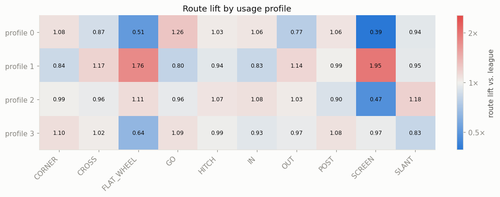
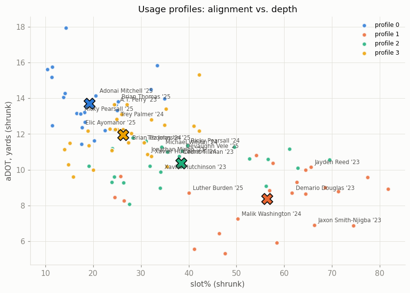

# nfl-bigdatabowl-2027

This project was developed for the NFL Big Data Bowl 2027, a data science competition promoted by the National Football league. The competition details are available [here](https://www.kaggle.com/competitions/nfl-big-data-bowl-2027).

# Project Proposal

In this project, the goal is map how NFL WR prospects profiles were generally used in the league and which kind of utilization maximized, the physical skills each prospect displayed in the NFL combine.

# Dataset

The data is provided by the competition ([Kaggle data page](https://www.kaggle.com/competitions/nfl-big-data-bowl-2027/data)). It covers **510 prospects from the 2023, 2024 and 2025 draft classes**: their NFL Combine results and tracking, and their NFL play-by-play and tracking data from the 2023 to 2025 seasons. This project focuses on the **106 wide receivers**.

| File | Grain | Content |
|---|---|---|
| `players.csv` | one row per player | identity, position, college, draft year/round/pick |
| `combine_results.csv` | one row per player | combine measurements (height, weight, hand size, arm length, wingspan) and drill results (40-yard dash, 10-yard split, vertical, broad jump, 3-cone, short shuttle, bench), plus NGS athleticism/production scores |
| `combine_tracking.csv` | one row per player × drill attempt × frame | player tracking during combine drills (position `x, y`, speed `s`, acceleration `a`, distance, direction) |
| `games.csv` | one row per game | 1,002 games: season (2023–2025), season type (147 preseason, 816 regular season, 39 postseason), week, teams |
| `player_play.csv` | one row per player × play | context (down, distance, formation, receiver alignment, coverage), result (pass result, air yards, yards gained, EPA) and player-level outcomes (`lined_up_position`, `route_ran`, target, receiving yards, YAC, separation at pass release, cushion, ...) |
| `game_tracking_2023/2024/2025.csv` | one row per player × play × frame | in-game player tracking (`x, y`, speed, acceleration, orientation, direction, play events) |
| `player_career_successes.csv` | one row per player | career outcomes: offensive/defensive/special-teams snaps, games active/started, All-Pro and Pro Bowl selections |

Things to keep in mind when reading the results:

- **Coverage depends on draft class.** A 2023 draftee can have up to three NFL seasons in the data, while a 2025 draftee has at most one. Most usage observations come from 2024–2025.
- **Plays nullified by penalty are removed.** For the usage profile, **preseason games are excluded** as well, because starters rest and depth players get extra snaps, so preseason usage doesn't reflect a player's real role. Postseason games are kept.

# Methodology

This analysis will be performed in 3 steps.

## 1- Usage Profile

How a WR performs in the NFL is highly determined by how he is deployed within a team ecosystem.  Offensive coaches choose players to perform specifics role in each play. The player then executes that designed action, which is an opportunity for production. 

Since the player utilization is a design choice, coaches have to decide which players are best fit for each role in single a play. Furthermore, the actual plays are also designed based on how to best fit the players available. It is therefore of high importance to understand how should a player be used to maximize his skills.

This step was designed to identify how was a player deployed in the NFL. It uses route distribution, average depth of target (aDOT) and alignment (SLOT%) to profile players.

The full analysis, with an explanation of each step, is in [`notebooks/UsageProfile.ipynb`](notebooks/UsageProfile.ipynb). The helper functions are in [`utils/usage_profile.py`](utils/usage_profile.py) and [`utils/metrics.py`](utils/metrics.py).

**1. Unit of analysis: the player-season.** A receiver's role can change from year to year (a new team, a new coordinator, a promotion to WR1), so each player-season gets its own profile instead of averaging a career into a role the player never actually had. Plays are joined to `games.csv` to get their season, keeping regular season and postseason games.

**2. Features.** For each player-season:
- **Route distribution:** the share of routes that are GO, HITCH, CROSS, IN, POST, OUT, CORNER, SLANT, SCREEN and FLAT. WHEEL and ANGLE are very rare for WRs (83 routes in total), so they are merged into FLAT.
- **Slot%:** the share of routes run from the slot (`lined_up_position == "SLOT_WR"`).
- **aDOT:** the average air yards (`pass_length`) on the player's targets.

**3. Statistical correctness.**
- **Minimum sample.** A bootstrap measured how far a route mix sampled from *n* routes drifts from the player's true mix (total variation distance). From **125 routes**, a typical sample mislabels less than 10% of the route tree. 100 of the 150 player-seasons reach this floor, and only those are used to fit the model.
- **Shrinkage.** Each feature is pulled toward the league average in proportion to how little data is behind it. The strength of each pull is estimated from the data:
  - **Route mix:** Dirichlet-multinomial, with a prior worth 73 routes of league-average behaviour.
  - **Slot%:** beta-binomial, with a prior worth 6 routes, toward the league slot rate of 35%.
  - **aDOT:** pulled toward the league aDOT of 11.0 yards. At 18 targets, a player's aDOT is half signal and half noise.
- **Compositional transform.** Route shares sum to 1, so they are transformed with the centered log-ratio (CLR), which makes Euclidean distance reflect *relative* differences between route trees. PCA then keeps 92% of the variance in 6 components.
- **Scaling and weighting.** Slot% (logit) and aDOT are standardized. The route components are rescaled as one block, so that **route tree, slot% and aDOT carry a 2 : 1 : 1 weight**: the route mix counts as much as alignment and depth combined.

**4. Clustering.** KMeans (50 restarts, fixed seed) on the 8-dimensional feature matrix. The silhouette score is highest at K = 2, but that split is simply slot vs. outside. From K = 3 to 8 the silhouette is flat (around 0.16–0.19) and the elbow has no clear bend. **WR usage is a continuum rather than a set of well-separated groups.** K = 4 was chosen as the smallest K that produces distinct football roles. Each profile is interpreted from its centroid, mapped back to route shares, slot% and aDOT, and from the player-seasons closest to that centroid.

The profiles, centroids and fitted model are saved in `data/processed/usage_profile/` (`usage_profile_df.parquet`, `centroids.csv`, `route_lift.csv`, `usage_model.joblib`, `metadata.json`), so later steps can reuse them or assign new player-seasons to the same profiles.

## 2- Prospect Profile

Using raw tracking data from combine drills, a general representation of the prospect profile should be developed. It is important to extract useful information from those drills to characterize the player based on his movement skills. 

## 3- Prospect -> Usage

Mapping how each prospect profile was later deployed in the NFL. Then correlate this to production metrics and performance scores.

In this step, which is the final goal of the project, the goal is understanding which is the best way to utilize a certain prospect type in terms of NFL usage deployment.

# Results

## Usage Profile

The 100 qualified player-seasons form four usage profiles:

| Profile | Player-seasons | Slot% | aDOT | Route tree vs. league average | Most typical player-seasons |
|---|---|---|---|---|---|
| **Vertical outside X** | 24 | 19% | 13.7 | GO 1.26×, CORNER 1.08×; almost no screens (0.39×), few outs (0.77×) | Adonai Mitchell '25, Ricky Pearsall '25, Brian Thomas '25 |
| **Outside intermediate** | 29 | 26% | 12.0 | balanced, slight downfield tilt (CORNER 1.10×, GO 1.09×, POST 1.08×); few flats (0.64×) and slants (0.83×) | Trey Palmer '24, Jonathan Mingo '23, Brian Thomas '24 |
| **Big slot / inside breaker** | 24 | 38% | 10.4 | SLANT 1.18×, IN 1.08×; few screens (0.47×) | Xavier Hutchinson '23, Michael Wilson '24, Ricky Pearsall '24 |
| **Slot underneath / gadget** | 23 | 56% | 8.4 | SCREEN 1.95×, FLAT 1.76×, CROSS 1.17×; fewer GO (0.80×) | Luther Burden '25, Malik Washington '24, Demario Douglas '23 |

*Slot% and aDOT are centroid values. "1.26×" means the profile runs that route 26% more often than the average WR.*

Main findings:

- **Usage mostly varies along one axis: depth and alignment.** It runs from the outside vertical receiver (few slot snaps, deep targets, almost no screens) to the slot underneath receiver (screens, flats and crossers at a short aDOT). In route-mix space, the first principal component (44% of the variance) is essentially SCREEN vs. GO/CORNER/POST.
- **The two outside profiles overlap the most.** They differ mainly in target depth (13.7 vs. 12.0 yards) and in how often the receiver runs screens and outs. The two slot profiles are better separated: the big slot works inside breaking routes at a medium depth, while the gadget slot is fed short, schemed touches.
- **Roles change between seasons.** Of the 30 players with two or more qualified seasons, **16 changed profile** at least once. Examples: Ricky Pearsall moved from big slot (2024) to vertical X (2025), and Brian Thomas from outside intermediate (2024) to vertical X (2025). This supports profiling player-seasons instead of players.
- **The groups are not sharply separated** (silhouette around 0.17 at K = 4). The profiles are best read as landmarks on a continuum of usage, not as hard labels. Later steps should keep the distance to the centroid, or the continuous features themselves, alongside the profile label.
- **Limitation:** 50 player-seasons (players with limited playing time) fall below the 125-route floor and have no profile yet.